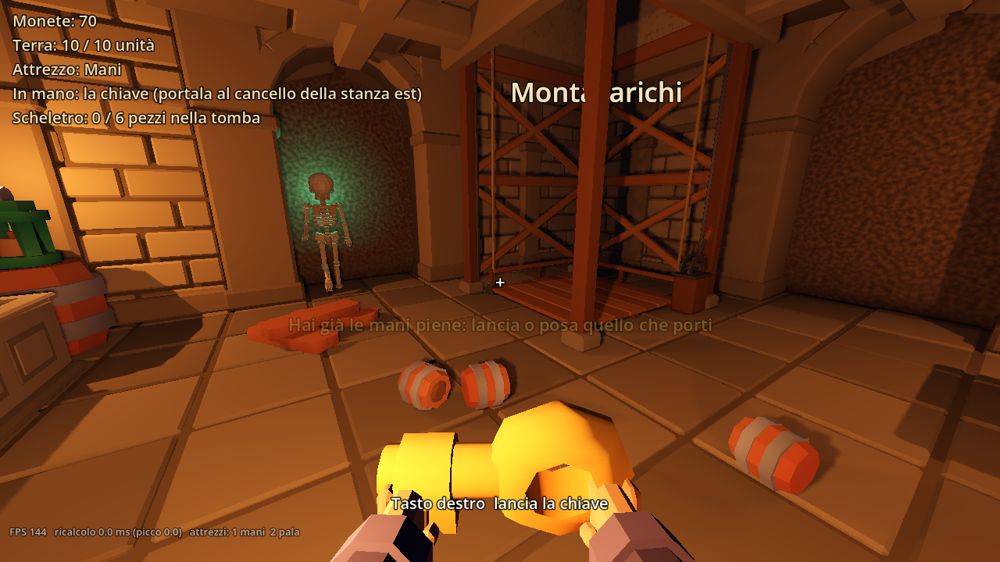

# Scava Catacomba

Gioco in prima persona, 3D dark fantasy, fatto con **Godot 4.7**.
Sei sepolto in una catacomba piena di terra: la scavi, la metti nei secchi, li lanci,
li raccogli e li impili sul montacarichi, li vendi e con le monete compri attrezzi
migliori, fino a liberare tutta la catacomba e trovare l'uscita nella stanza finale.

> **Stato:** prototipo. Sono pronte le fasi 0–2 (terreno scavabile, feedback dello scavo,
> ciclo base secchi → montacarichi → vendita → negozio).



## Caratteristiche

- **Terra come massa continua**, non a blocchi: si consuma attorno al punto mirato
  (campo di densità + mesh *surface nets*, ricalcolata a chunk mentre scavi).
- **Tre tipi di terreno**: terra, terra dura (serve la pala) e roccia (serve il piccone).
  La pietra di stanze e corridoi non si scava.
- **Feedback dello scavo**: schegge, suoni generati via codice, scossa della camera
  e animazione dell'attrezzo in mano.
- **Ciclo di gioco**: la terra scavata va nell'attrezzo; con 10 unità riempi un secchio,
  lo lanci e continui a scavare. Poi raccogli i secchi uno alla volta (con un secchio
  in mano non scavi) e li posi sul montacarichi: +10% di bonus ogni 5 secchi mandati su
  insieme. Negozio con pala, sacca capiente e piccone.
- **Ossa e scheletri**: scavando trovi i 6 pezzi di uno scheletro sepolti nella terra. Si raccolgono
  e si lanciano come i secchi e si posano nella tomba aperta dello spawn; completo, lo scheletro si alza.
- **Multigiocatore co-op online** (fino a 4): stessa catacomba, monete, montacarichi, negozio e
  tomba in comune; ognuno ha la sua terra nell'attrezzo e quello che tiene in mano.
- **Niente crolli, niente mostri.** In futuro: ossa e scheletri che si usurano e si riparano.

## Comandi

| Tasto | Azione |
|---|---|
| `W` `A` `S` `D` | Muoversi |
| Mouse | Guardarsi intorno |
| Tasto sinistro (tenuto) | Scavare |
| `Spazio` | Saltare |
| `Q` | Riempire un secchio (servono 10 unità di terra) |
| Tasto destro | Lanciare il secchio che hai in mano |
| `E` | Raccogliere un secchio o un osso, posarlo sul montacarichi o nella tomba, tirare la leva, aprire/chiudere il negozio |
| `1` `2` `3` | Mani, pala, piccone (se comprati) |
| `Esc` | Menu di pausa / chiudere il negozio |
| `F` | Prendere in mano un candelotto di dinamite (tasto destro per lanciarlo, esplode dopo 3 s) |
| `R` | Posare una rotaia sul pavimento che guardi / togliere quella che guardi |
| `Ctrl+M` | Dev tool: monete, attrezzi, volo, velocità, ossa, tomba, tempo, rigenera terra |

## Novità

- **Negozio a livelli**, diviso in categorie: pala e piccone (4 livelli), sacca (fino a 40 unità),
  gerla (porti 2-3 secchi insieme), braccia forti (lanci più lontano), piattaforma del montacarichi
  (fino a 125 secchi), argano (bonus pila più alto), scheletri instancabili, rotaie, carrello, dinamite.
- **Dinamite**: consumabile, al massimo 4 nell'inventario. `F` per prenderla, tasto destro per lanciarla:
  dopo 3 s esplode e toglie una grossa sfera di terra, anche la roccia.
- **Scheletri lavoratori**: ogni scheletro ricomposto nella tomba si mette al lavoro. Se ci sono secchi
  a terra li porta al montacarichi, altrimenti scava un secchio e lo porta lui.
- **Rotaie e carrello**: compri pacchi di rotaie e li posi con `R` (si collegano da soli). Nel carrello
  metti fino a 6 secchi (`E`), lo spingi camminandoci contro e accanto al montacarichi si ribalta.
- **Prima zona completa**: 9 stanze collegate da un anello di cunicoli, terra più dura lontano dallo
  spawn, due scheletri da ricomporre e la **chiave** sepolta che apre il cancello verso la prossima zona.
- **Salvataggio**: 3 slot. Chi gioca da solo o ospita salva ogni minuto, a ogni vendita, dal
  menu di pausa e alla chiusura.
- **Menu principale**: Continua partita (l'ultimo slot salvato), Carica partita (scegli o elimina
  uno slot), Nuova partita (in uno slot, chiede prima di sovrascrivere), Co-op, Impostazioni
  (volume, sensibilità del mouse, campo visivo, schermo intero, V-Sync), Esci.
- **Menu di pausa** (`Esc`): Riprendi, Impostazioni, Salva, Menu principale, Esci. Da solo il gioco
  si ferma; in co-op gli altri continuano.
- **Co-op**: gli altri giocatori sono becchini-minatori low-poly col mantello di un colore diverso.

## Come avviarlo

1. Scarica [Godot 4.7](https://godotengine.org/download) (versione standard, non .NET).
2. Clona il repository e apri `project.godot` con Godot.
3. Premi **F5** (scena di avvio: `scenes/menu_principale.tscn`). Con **F6** su `scenes/main.tscn`
   si entra subito nel gioco, nell'ultimo slot salvato.

Da riga di comando:

```
godot --path .
```

All'avvio c'è il menu principale. In **Co-op online** si ospita una partita (scegliendo lo slot in
cui salvarla) o si entra scrivendo l'indirizzo di chi ospita.

I salvataggi sono in `user://salvataggi/slot_1.dat` … `slot_3.dat` (su Windows
`%APPDATA%\Godot\app_userdata\Scava Catacomba\`). Il vecchio `salvataggio.dat`, se c'è, viene
copiato nello slot 1 la prima volta (l'originale resta). Le impostazioni sono in
`user://impostazioni.cfg`.

### Giocare online

- Chi **ospita** usa la porta **UDP 7777**. Il gioco prova ad aprirla da solo sul router (UPnP):
  se ci riesce, in basso a sinistra compare l'IP pubblico da dare agli amici.
- Se il router non lo permette: apri a mano la porta UDP 7777 verso il PC di chi ospita, oppure
  usate tutti una VPN tipo [Tailscale](https://tailscale.com), ZeroTier o Radmin VPN e collegatevi
  all'IP della VPN.
- Sulla stessa rete di casa basta l'IP locale (es. `192.168.1.20`).
- Chi ospita tiene la partita: se esce, la partita finisce per tutti. Chi entra dopo riceve la
  catacomba già scavata, i secchi e le ossa a terra e le monete.

Da riga di comando, senza menu:

```
godot --path . -- --host --nome Anna
godot --path . -- --join 192.168.1.20 --nome Bruno
```

### Prove automatiche

```
godot --path . -- --loop    # prova il ciclo secchio -> lancio -> montacarichi -> vendita -> negozio
godot --path . -- --bench   # scava da solo 6 s, salva le misure in bench.txt e uno screenshot in shot.png
godot --headless --path . -- --host --provarete              # prova in rete: prima il server...
godot --headless --path . -- --join 127.0.0.1 --provarete    # ...poi il client (lancia, vende, compra, scava, tomba)
```

## Struttura del progetto

```
scenes/
  main.tscn          scena principale: Catacomba, Soffitto, Terra, Spawn, Player, HUD
  player.tscn        giocatore, camera, attrezzi in mano, suoni, schegge
  hud.tscn           interfaccia e negozio
  secchio.tscn       secchio pieno lanciabile (la botte del Mini Dungeon)
  pezzi/             i pezzi della catacomba (modello + collisione + volume di terra): cripta-* e i pezzi del Modular Cave Kit
scripts/
  terrain.gd         terreno scavabile (densità, surface nets, chunk) — @tool, anteprima nell'editor
  player.gd          movimento, mira, scavo, interazioni
  viewmodel.gd       animazione dell'attrezzo in mano
  dig_sfx.gd         suoni dello scavo
  game_state.gd      monete, terra raccolta, secchi sul montacarichi, negozio
  scheletro.gd       scheletro scomponibile: togli_parte / metti_parte, idle e camminata solo se completo, alzati() per uscire dalla tomba
  osso.gd            pezzo di scheletro da trovare, raccogliere, lanciare e posare nella tomba
  dev_tool.gd        pannello dei comandi di prova (Ctrl+M)
  secchio.gd         il secchio pieno che si lancia (fisica)
  spawn_room.gd      arredo dello spawn: montacarichi, leva, negozio
  hud.gd             interfaccia
  main.gd            collega tutto, multigiocatore (richieste al server, sincronizzazione) + prove automatiche
  rete.gd            autoload "Rete": ospita / entra (ENet, porta 7777, UPnP), elenco dei giocatori
  menu_principale.gd menu di avvio (scena scenes/menu_principale.tscn: sfondo e pulsanti si modificano nell'editor)
  pausa.gd           menu di pausa (Esc)
  salvataggi.gd      slot di salvataggio (intestazione per il menu + partita intera)
  impostazioni.gd    autoload "Impostazioni": volume, mouse, campo visivo, schermo intero, V-Sync
  pannello_impostazioni.gd  il pannello delle impostazioni (menu principale e pausa)
  tema.gd            stile dei menu (pannelli scuri, bordi in ottone)
  giocatore_remoto.gd  come si vedono gli altri giocatori (corpo, nome, fiamma, attrezzo in mano)
tools/
  build_scenes.gd    rigenera le scene da codice
  low_poly.gd        costruttore di modelli low-poly stile Kenney (blocchi smussati, archi) usato dai due script sotto
  make_models.gd     genera mani, pugno, piccone, montacarichi (castello e piattaforma), leva, negozio, pala, cassa, tomba e berretto (in modelli/)
  make_skeleton.gd   genera lo scheletro in 6 pezzi (in modelli/scheletro/) e la scena scenes/scheletro.tscn con le animazioni
  make_crypt.gd      genera i pezzi della catacomba: cunicoli scavati nella roccia (corridoio, fondo, curva, T, incrocio) e stanza in mattoni (in modelli/cripta/)
modelli/             mani, pugno, piccone e pezzi della cripta in stile Kenney (GLB, apribili anche in Blender)
audio/               suoni provvisori generati
assetpack/           modelli 3D (Kenney, CC0)
```

## Modificare la catacomba

Stanze e corridoi sono i pezzi in `scenes/pezzi/`, figli del nodo **Catacomba** in `main.tscn`.
La catacomba usa i pezzi `cripta-*`. I cunicoli sono scavati nella roccia, con la volta e i loculi:
`cripta-corridoio` (lungo X, in tre varianti), `cripta-fondo` (aperto verso +X), `cripta-curva`
(aperta verso -X e -Z), `cripta-t` (chiusa verso +Z), `cripta-incrocio`. Le stanze hanno muri in
blocchi di tufo con portali ad arco: `cripta-stanza` (12 x 12 m, un portale per lato).

1. Trascina un pezzo dentro **Catacomba**, allineato alla griglia da 4 m (pavimento a `y = 2`).
2. Seleziona il nodo **Terra** e premi **Rigenera terra** nell'Inspector: il pezzo si riempie di terra.
3. Per lasciare un pezzo vuoto, imposta il suo meta `terra` a `false`.

> ⚠️ `tools/build_scenes.gd` rigenera le scene da zero e **sovrascrive le modifiche fatte a mano**:
> usalo solo se vuoi ripartire dalla pianta definita nello script.
>
> ```
> godot --headless --path . res://tools/build_scenes.tscn
> ```

> Il negoziante (scheletro col berretto) è nella scena `scenes/negoziante.tscn`: aprila per spostare
> il berretto o cambiare il personaggio. Il builder la crea solo se non esiste e non la sovrascrive.

## Prossime fasi

- Rotaie a pezzi e vagone spinto a mano che porta i secchi al montacarichi

3. Ossa e primo scheletro (modello in 6 pezzi con idle e camminata: fatto)
4. Materiali e progressione (usura e riparazione degli scheletri)
5. Prima zona completa

## Crediti

Modelli 3D di [Kenney](https://www.kenney.nl) — licenza **CC0**:
[Modular Cave Kit](https://kenney.nl/assets/modular-cave-kit),
[Mini Dungeon](https://kenney.nl/assets/mini-dungeon),
[Graveyard Kit](https://kenney.nl/assets/graveyard-kit).
